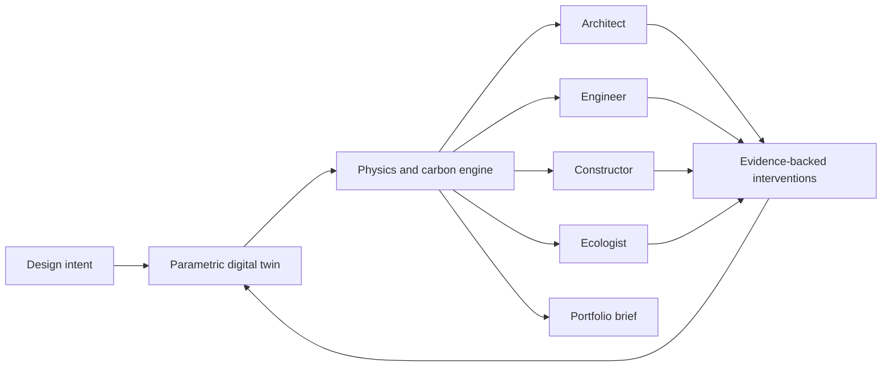
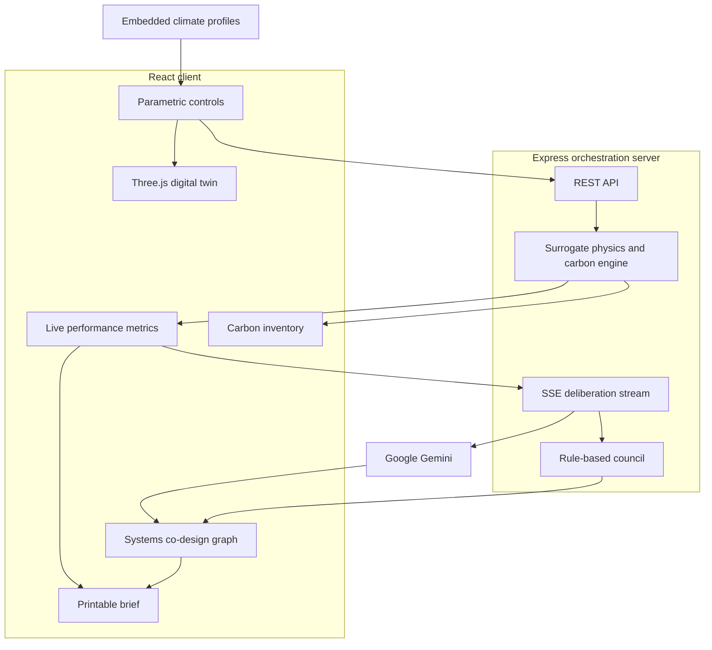

# SYMBIOCEN

## A Regenerative Urban Digital Twin for Designing Buildings That Give More Than They Take

**Real-time physics. Whole-life carbon. Multi-agent intelligence. One shared design surface.**

[](https://react.dev/)
[](https://www.typescriptlang.org/)
[](https://threejs.org/)
[](https://ai.google.dev/)
[](https://vite.dev/)

---

## The Challenge

Buildings are responsible for a profound share of global material use, energy demand, and carbon emissions. Yet the people who shape them still work through fragmented handoffs: architecture proposes, engineering checks, construction prices, and ecology reacts.

By the time the consequences become visible, the most important decisions have already hardened into concrete, steel, cost, and carbon.

**Symbiocen asks a different question:**

> What if every design decision could reveal its structural, climatic, ecological, and carbon consequences while it was still only an idea?

Symbiocen is an interactive regenerative-design environment that treats a building not as an isolated object, but as a living metabolism within an urban ecosystem. A parametric 3D twin, rapid surrogate simulation, climate intelligence, material accounting, and a four-discipline AI council operate together in one continuous feedback loop.

This repository is the working prototype of that idea.

## The Core Thesis

The decisive innovation is not another model, dashboard, or chatbot. It is the **collapse of disciplinary latency**.



A student or designer changes the massing, structure, envelope, orientation, or landscape. Symbiocen immediately recomputes the consequences, asks each discipline to interpret them, and offers concrete interventions that can be applied back to the shared model.

That loop turns sustainability from a report written after design into a medium through which design happens.

## What You Can Do Today

### Shape a living digital twin

Explore four regenerative typologies, alter floor count and geometry, rotate the building, tune facade porosity, deepen solar shading, compare structural systems, and inspect an exploded assembly in a responsive Three.js viewport.

Analytical views expose solar, daylight, stress, and thermal behavior. A simulated Boston sun path moves from dawn through night, changing illumination and shadow conditions across the model.

### See consequences in real time

The local surrogate engine provides immediate comparative feedback across five coupled domains:

| Domain | Live indicators |
| --- | --- |
| Whole-life carbon | Embodied carbon intensity, total GWP, biogenic storage, circularity rating |
| Operational energy | EUI, annual emissions, photovoltaic yield, net-zero readiness |
| Daylight | sDA 300/50%, ASE, glare risk, average illuminance |
| Structure | Wind deflection, H/400 drift check, utilization, safety factor |
| Ecology | Green cover, stormwater retention, microclimate cooling, biodiversity score |

### Convene a multidisciplinary council

A streamed deliberation brings four perspectives to the same design state:

- **Architect**: massing, daylight, circulation, and biophilic experience
- **Engineer**: lateral stiffness, structural utilization, envelope loads, and system safety
- **Constructor**: prefabrication, transport, crane logistics, sequencing, and constructability
- **Ecologist**: life-cycle carbon, habitat, stormwater, circularity, and climate resilience

With a Gemini API key, the council generates contextual critiques from the current metrics. Without one, the application remains fully demonstrable through a deterministic, high-fidelity fallback council.

### Compare material futures

The EC3-inspired inventory turns geometry and specifications into a dynamic bill of materials. It contrasts conventional and lower-carbon assemblies across substructure, superstructure, envelope, finishes, and renewables, including GWP, recycled content, circularity, and substitution opportunities.

### Design with climate, not against it

Site profiles for **Boston, Flint, Seattle, and Denver** connect monthly temperature, solar irradiance, wind, humidity, and precipitation to climate-responsive design strategies. Recommendations can update the active building parameters directly.

### Produce an evidence-rich design brief

The export workflow assembles geometry, carbon, energy, daylight, structural, ecological, and council findings into a printable executive sustainability brief suitable for studio reviews, mentorship programs, and design portfolios.

## A Typical Design Loop

1. Select a city and regenerative building typology.
2. Tune orientation, floor plate, glazing, shading, structure, insulation, green roof, and photovoltaics.
3. Inspect the model through physical and analytical viewport modes.
4. Compare live carbon, energy, daylight, structural, and ecological outcomes.
5. Run the Agent Council and apply a recommended intervention.
6. Review causal relationships in the systems co-design graph.
7. Export the final evidence trail as a portfolio brief.

## Architecture



### Technology

| Layer | Implementation |
| --- | --- |
| Experience | React 19, TypeScript, Tailwind CSS, Motion, Lucide |
| Spatial computing | Three.js, OrbitControls, procedural geometry and analytical shader modes |
| Data interaction | TanStack Query, TanStack Table, D3 |
| Simulation | Deterministic TypeScript surrogate models for rapid comparative feedback |
| Agent orchestration | Express, Google Gemini, Server-Sent Events, rule-based offline fallback |
| Tooling | Vite 6, TSX, TypeScript |

## Run Locally

### Prerequisites

- Node.js 22 recommended
- npm
- A Gemini API key only if you want generative council responses

### Installation

```bash
git clone <repository-url>
cd symbiocen-rudt
npm install
```

Create a `.env` file for AI-assisted deliberation:

```bash
GEMINI_API_KEY=your_api_key_here
PORT=3000
```

The key is optional. The deterministic simulation, digital twin, climate tools, material inventory, exports, and fallback council all work without it.

Start the integrated Express and Vite development server:

```bash
npm run dev
```

Open [http://localhost:3000](http://localhost:3000).

### Quality Checks

```bash
npm run lint
npm run build
```

For a production run:

```bash
npm run build
NODE_ENV=production npm start
```

## API Surface

| Method | Endpoint | Purpose |
| --- | --- | --- |
| `GET` | `/api/health` | Server and Gemini configuration status |
| `POST` | `/api/simulate/run` | Recompute building metrics and material inventory |
| `GET` | `/api/materials/catalog` | Retrieve the low-carbon materials catalog |
| `POST` | `/api/agents/deliberate` | Stream four council responses over SSE |
| `POST` | `/api/agents/consult` | Ask one discipline a focused design question |

## Scientific Integrity

Symbiocen currently uses transparent, deterministic **surrogate equations** designed for immediate comparative exploration. They encode relationships among geometry, envelope design, structural stiffness, material choice, solar exposure, energy demand, and ecological coverage.

They are not substitutes for validated whole-building energy models, finite-element analysis, computational fluid dynamics, certified environmental product declarations, code review, or licensed professional judgment. Compliance labels and projected impacts in the prototype are educational decision-support signals, not certifications.

That distinction matters. The route from a compelling prototype to consequential science depends on calibration, uncertainty quantification, reproducibility, and independent validation.

## From Prototype to Research Platform

The next research frontier is to make every recommendation traceable, testable, and locally accountable:

- Calibrate surrogate outputs against EnergyPlus, Radiance, OpenFOAM, and structural FEM reference cases.
- Attach uncertainty intervals and sensitivity analysis to every reported metric.
- Replace representative material factors with versioned EPD and EC3-compatible datasets.
- Add geospatial context, urban morphology, local grids, zoning, and future climate scenarios.
- Track design provenance so every parameter change, agent claim, and outcome is reproducible.
- Evaluate human learning outcomes in ACE Mentor Program and university design studios.
- Measure whether interdisciplinary feedback changes real design decisions and whole-life carbon outcomes.
- Publish benchmark datasets, model cards, validation protocols, and longitudinal results openly.

## Why This Matters

The built environment is not merely an emissions problem. It is where climate, public health, biodiversity, education, labor, materials, and human dignity meet.

A generation of designers should not have to choose between imagination and evidence. They should be able to see a building as structure and habitat, cost and carbon, shelter and watershed, artifact and living system, all at once.

Symbiocen is an attempt to make that systems literacy tangible: not by replacing architects, engineers, builders, or ecologists, but by giving them a shared language early enough to change the outcome.

> **The ambition is simple to state and difficult to achieve: make regenerative design understandable, collaborative, measurable, and available before the first irreversible decision is made.**

## Repository Guide

```text
src/
├── components/
│   ├── agents/       # Council and systems co-design graph
│   ├── charts/       # Site climate visualization
│   ├── export/       # Printable sustainability brief
│   ├── inventory/    # Dynamic carbon and materials table
│   ├── navigation/   # Application navigation
│   └── viewport/     # Three.js regenerative digital twin
├── types/            # Shared domain model
├── utils/
│   ├── climateData.ts
│   └── physicsEngine.ts
└── App.tsx            # Integrated design workspace

server.ts              # Express API, Gemini orchestration, SSE streaming
```

## Contributing

Contributions are especially valuable in building-science validation, life-cycle assessment, structural engineering, urban ecology, climate data, accessible visualization, AI evaluation, and design education.

When proposing a new metric or model, document its assumptions, units, valid range, source data, and validation method. The quality of this project will be measured not by how certain it sounds, but by how clearly its claims can be examined.

---

**SYMBIOCEN** · From isolated objects to living urban systems

*Built for the designers, engineers, constructors, ecologists, and students who refuse to inherit disciplinary boundaries as planetary limits.*
